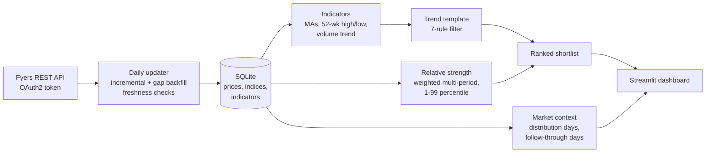
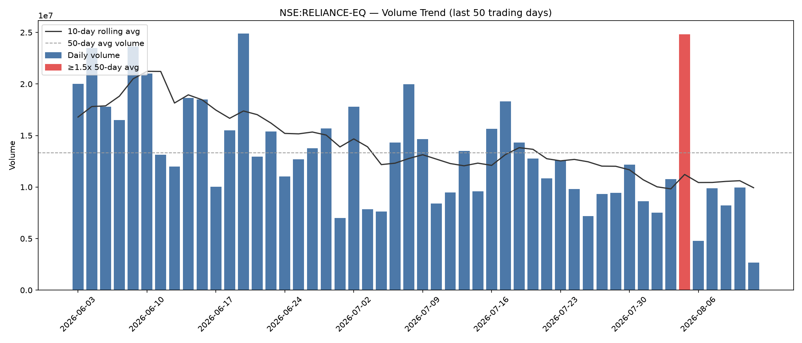
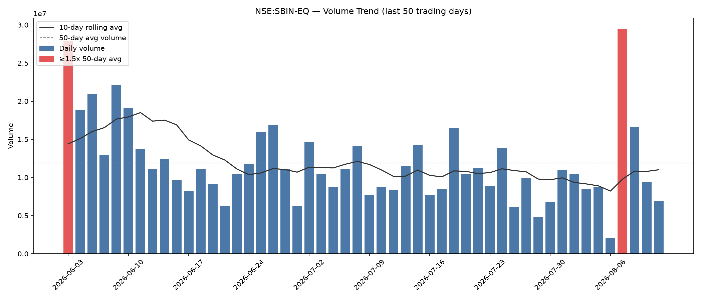

# TradeForge: Automated NSE Stock Screener

An end-to-end quantitative screening platform for Indian equities. It implements a SEPA-style trend template (Minervini) with relative-strength ranking across **750+ NSE stocks in 5 market-cap tiers** (Nifty 50, Next 50, Midcap 150, Smallcap 250, Microcap 250).

It turns a multi-hour manual screening routine into **one automated daily run** that produces a ranked, auditable shortlist of roughly 20–150 candidates (tunable).

## Pipeline



## Features

- **Trend template engine:** 7 rules (moving-average alignment, 52-week high/low positioning), each recorded as a pass/fail result, so every decision can be audited (`src/scanner/`)
- **Relative-strength ranking:** weighted multi-period momentum scored against the whole universe as a 1–99 percentile, plus sector-level RS aggregation (`src/ranking/`)
- **Pattern detection:** base/consolidation and contraction (VCP-style) detection with duration tracking (`src/patterns/`)
- **Market health:** distribution-day counting and follow-through-day detection (`src/market_context/`)
- **Self-healing data pipeline:** incremental updates, automatic gap backfill, data-freshness validation, and holiday-aware outcome classification (advanced / unchanged-holiday / partial / failed) so a no-data day is never mistaken for a failure (`src/data/`, `run_daily.py`)
- **Streamlit dashboard:** multi-parameter filters, sortable results, drill-down detail views, charts and one-click CSV export (`app.py`)
- **Clean architecture:** repository pattern for all database access, one responsibility per module, configuration from environment variables

## Run

```bash
python -m venv .venv && source .venv/bin/activate
pip install -r requirements.txt
cp .env.example .env          # add your Fyers API credentials
python run_daily.py           # update data + run the scan
streamlit run app.py          # open the dashboard
```

Index constituent lists (public NSE data) are in `assets/indices/`. The local database, logs and outputs are git-ignored.

## Screenshots

| | |
|---|---|
|  |  |

## Tech

Python · pandas / NumPy · SQLite · Streamlit · Fyers API (REST, OAuth2) · cron on Linux (AWS EC2 via SSM) · Git

## Docs

[Project vision](docs/01_Project_Vision.md) · [Roadmap](docs/00_Project_Roadmap.md) · [Engineering principles](docs/02_Engineering_Principles.md)

---
Educational / research tool. Not investment advice.
